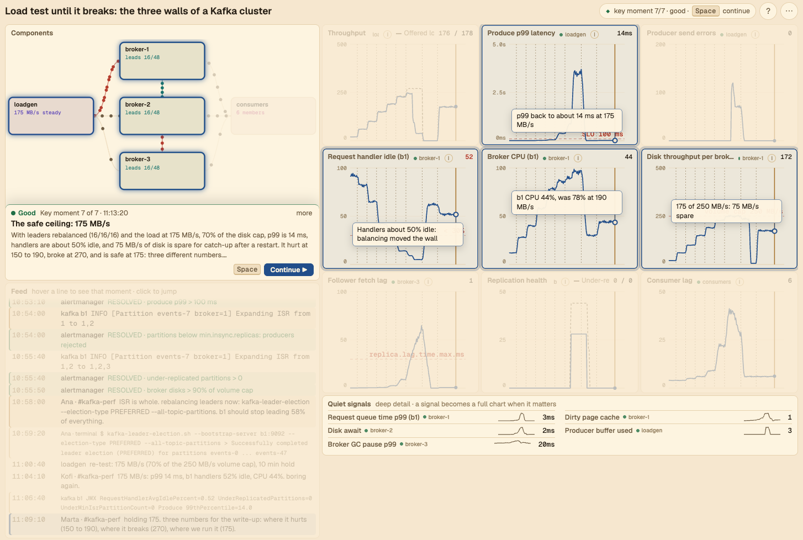

# sim-xp

**Simulate a blog, an incident or a load test.**

A new way for engineers to share and build experience. Agents turn any blog, incident or concept into a
simulation that brings you closer to reality, and saves you the reading.

```
experience ──encode──▶ playbook.json ──run──▶ simulation
```

**Start playing:** https://smarchone.github.io/sim-xp/v2/ · **About:** https://smarchone.github.io/sim-xp/

## The problem

- There's a gap between reading about a system and experiencing it live.
- Simulations close that gap. Not exact, but much closer.
- Agents make it fast: one story in, one simulation out.



## How to create playbooks

The `story-to-playbook` skill turns a blog post, postmortem, concept or short prompt into a validated
`playbook.json`. Install it once:

```sh
npx skills add smarchone/sim-xp --skill story-to-playbook -g
```

Then give it a story in Claude Code:

```
/story-to-playbook https://github.blog/news-insights/company-news/oct21-post-incident-analysis/
/story-to-playbook "Postgres as a job queue, load tested until it breaks"
/story-to-playbook "How a Kafka consumer rebalance storm starts and ends"
```

Open the file in the [player](https://smarchone.github.io/sim-xp/v2/) (drop it on the page, or *Open file…* in
the side panel) and press Space.

## Import playbooks from a GitHub repo

The player's **Library** (side panel) lists playbooks straight from GitHub repos and loads one only when you click it.
[smarchone/simxp-playbooks](https://github.com/smarchone/simxp-playbooks) is the default; to import another repo, type
`owner/repo` (or `owner/repo@branch/folder`, or paste its github.com link) into the Library and press Add. Each import is a
collapsible group, ▶ loads and runs a playbook, and ↻ refetches the list. Opened playbooks are cached in your browser for a week;
nothing else is stored apart from the repos you added.

To publish your own: put the playbook files in a public repo with an `index.json` next to them (the
[simxp-playbooks](https://github.com/smarchone/simxp-playbooks) repo has a `node build-index.mjs` that writes it from the files), then
import it as above. A playbook's link names its repo, so it works for someone who hasn't added it:

```
https://smarchone.github.io/sim-xp/v2/#smarchone/simxp-playbooks:postgres-queue-load-test
```

The index format and details are in [`v2/README.md`](v2/README.md#playbook-repos-the-library).

## In this repo

- [`v2/`](v2/): the player, side panel and bundled playbooks, built into one file.
- [`docs/`](docs/): the landing page, served at the site root.
- [`.claude/skills/story-to-playbook/`](.claude/skills/story-to-playbook/): the skill.
- [`mvp/`](mvp/) (deprecated): incident drills you operate yourself. Not deployed; kept for reference.

Part of [agentic experiences](https://smarchone.github.io/agentic-experiences): accelerate learning with agents.
