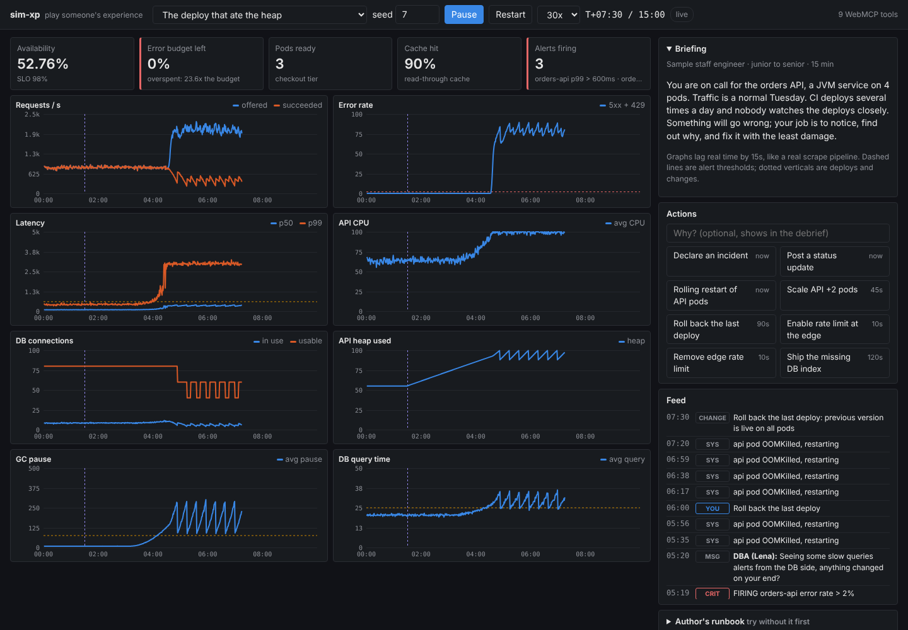

# sim-xp MVP



A small web app to get a feel for **sharing experience as something people play**. A senior engineer
encodes an incident they lived through as a **playbook** (one JSON file). The app's deterministic core turns
it into a live, Grafana-style dashboard with simulated metrics, alerts, noise and a chat feed. The learner
(a human, or an agent through WebMCP) watches, decides and acts. At the end, a debrief puts their moves next to
what the author did and why.

```
 senior's war story ──► playbook.json ──► deterministic core ──► dashboard + alerts + feed
                         (story, faults,     (load, saturation,          │
                          alerts, actions,    retries, pools, GC)        ▼
                          runbook, debrief)                     learner acts (human or agent)
                                                                         │
                                                       debrief: you vs the author ◄┘
```

## Run it

Live at **https://smarchone.github.io/sim-xp/** (deployed from `main` by `.github/workflows/pages.yml`).

Locally there's no build step and no dependencies. Serve the folder over http:

```sh
cd mvp
python3 -m http.server 3000      # or: npx serve -l 3000
# open http://localhost:3000
```

Pick a playbook, press **Start**, and play. Speed defaults to 10x, so a 15-minute drill takes about 90 seconds.

Tests (engine only): `node --test mvp/test/*.test.mjs`

## What's in it

| Path | What it is |
|---|---|
| `js/engine.js` | The deterministic core. One `step()` is one simulated second. Same playbook + seed + actions = same run. No DOM. |
| `js/app.js` | The page: dashboard, actions, feed, debrief, and the WebMCP tools. |
| `js/charts.js` | Canvas time-series panels: thresholds, deploy annotations, hover crosshair. |
| `playbooks/` | Two example experiences: a flash sale with a cold cache and a too-small DB pool, and a deploy that leaks heap into a GC death spiral. |
| `PLAYBOOKS.md` | How to write one. |
| `commands/` | Claude Code slash commands to play a drill or turn a story into a playbook. |

### The core, briefly

The system is `edge → API pods → cache → Postgres`. Playbooks never script metric values. They start
**faults** (`traffic_spike`, `cache_degrade`, `slow_query`, `memory_leak`, `bad_deploy`) and the core works out
what happens: queueing, saturation, client retries that amplify load, a connection pool that runs out,
GC pauses, OOM kills. Learner **actions** (`rate_limit`, `scale_api`, `rollback`, `warm_cache`, …) also change the
system and take effect after a realistic delay. That's why the obvious move can make things worse: scaling
the API in the flash sale adds connections the DB doesn't have.

Some things are deliberately imperfect, because real incidents are: graphs lag by a scrape interval (15s),
there's noise, and each playbook includes a red herring.

## Agents (WebMCP)

The page registers tools on `document.modelContext`, the same pattern as
[webmcp-apps/dino](https://github.com/smarchone/webmcp-apps/tree/main/apps/dino). Time is frozen between an
agent's calls, so it can think as long as it needs.

| Tool | What it does |
|---|---|
| `list_playbooks` | Playbooks loaded in the page |
| `start_drill` | Load one and start in agent mode; returns the briefing, actions and first snapshot |
| `advance` | Let up to 300s pass; stops early on a new alert or message |
| `query_metrics` | Lagged history for chosen metrics |
| `take_action` | Act on the system, with a reason |
| `get_runbook` | The author's advice |
| `get_debrief` | Scores, your moves vs the author's, traps hit, lessons |
| `get_playbook_format` | Fields, faults, actions and metrics, with an example |
| `install_playbook` | Validate a new playbook and load it into the page |

With the [WebMCP bridge](https://github.com/smarchone/webmcp-apps):

```sh
claude mcp add webmcp -- npx -y @smarchone/webmcp-bridge
claude "Open https://smarchone.github.io/sim-xp/ with the webmcp tools and play the gc-death-spiral drill"
```

`commands/run-drill.md` and `commands/write-playbook.md` are slash commands for the two loops: playing, and
turning a senior's story into a new playbook that the engine validates. The page's "Let Claude Code play this"
tip has copy-paste install commands for both.

## Not in the MVP

Accounts, a shared library, ratings and forks, an AI cast that replies, an AI judge of reasoning, multiplayer,
campaigns. Sharing today is: download the JSON, send it, load it.
